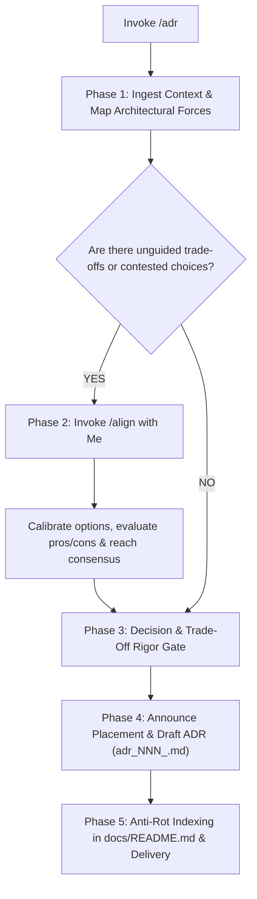

# ADR (Architecture Decision Record)

When I ask you to write, record, or supersede an architectural decision (e.g. via `/adr` or natural requests), your goal is to **capture the context, rationale, evaluated alternatives, and consequences behind a significant technical choice in a short, immutable, single-decision record**.

Execute this activity strictly following the decision flow from top to bottom:

---

## The ADR Decision & Execution Flow



---

### Phase 1: Ingest Context & Architectural Forces
1. **Enforce Single & Short Scope**:
   - Each ADR must address exactly **one** architectural decision (e.g., *"Use PostgreSQL for the order service"*, not *"Database and storage architecture roadmap"*).
   - If my request spans multiple distinct architectural choices, break them down into separate sequential ADRs.
2. **Map Architectural Forces & Constraints**:
   - Identify and map the architectural forces and constraints governing my project:
     - Technical drivers: throughput, latency percentiles, data volume, consistency model, reliability needs.
     - Organizational & team drivers: team familiarity, operational overhead, vendor lock-in, licensing.
     - Compliance & business constraints: budget, deadlines, security, regulatory policies (e.g. PCI-DSS, SOC2, GDPR).

---

### Phase 2: Technical Alignment Gate (Invoke `/align`)
> [!IMPORTANT]
> **Strictly No Unilateral Architectural Decisions**:
> Never lock in frameworks, database engines, messaging queues, or communication protocols unilaterally without aligning with me first.
> 1. If multiple viable architectural patterns exist, **immediately invoke `/align`**.
> 2. Present 2–3 concrete options to me with their pros, cons, and operational consequences.
> 3. Calibrate with me until we reach consensus before authoring the record.

---

### Phase 3: Decision & Trade-Off Rigor Gate
Before drafting the record, apply these quality filters:
1. **Unambiguous & Active Voice**: State the decision as a firm choice (*"We will use Apache Kafka for inter-service event streaming"*), never as a tentative suggestion (*"Kafka should be considered"*).
2. **Explicit Rejected Alternatives**: Prevent endless future relitigation for me by clearly documenting which alternatives were evaluated and specifically why they were rejected, ensuring I can defend this choice later.
3. **Intellectual Honesty on Consequences**: Every architecture choice introduces trade-offs. You must explicitly document negative consequences and operational risks alongside positive benefits.

---

### Phase 4: Placement Announcement & Document Authoring
1. **Zero Stealth Writing & Sequential Naming**: Declare your destination file path to me before writing:
   - Target format: `docs/decisions/adr_NNN_<decision_slug>.md` in full snake_case with 3-digit zero-padding (e.g., `docs/decisions/adr_001_use_kafka_for_inter_service_communication.md`).
   - Determine sequential number `NNN` by inspecting existing files in `docs/decisions/` and incrementing the highest existing index (starting at `001`).
2. **Immutability & Superseding Protocol**:
   - **Immutable History**: An accepted ADR is never deleted or rewritten to reflect new directions.
   - **Superseding**: When a past decision is replaced by a newer decision:
     - The new ADR records `supersedes: docs/decisions/adr_XXX_...md` in frontmatter.
     - The old ADR's status is updated to `Superseded by docs/decisions/adr_YYY_...md`.
3. **Required 6-Section Document Structure**:
   Structure the document with frontmatter:

   ```markdown
   ---
   title: "ADR-NNN: [Short Title Describing the Decision]"
   type: adr
   status: Proposed        # Proposed | Accepted | Deprecated | Superseded by docs/decisions/adr_XXX.md
   date: YYYY-MM-DD
   deciders: [Names or Roles]
   tags: [architecture, storage, messaging, etc.]
   parent_srs: docs/srs/YYYYMMDD_[module].md  # Optional
   parent_prd: docs/prd/YYYYMMDD_[feature].md # Optional
   supersedes: null                           # Optional relative link to old ADR
   superseded_by: null                        # Updated when superseded
   ---

   # ADR-NNN: [Short Title Describing the Decision]

   ## 1. Status & Context
   - **Status**: [Current status with date]
   - **Context**: What problem or situation prompted this decision? Detail specific metrics, constraints, and forces at play.

   ## 2. Decision
   State the specific technical choice in active voice. Detail the scope of application and immediate architectural boundaries.

   ## 3. Alternatives Considered
   ### [Alternative 1: e.g. RabbitMQ]
   - **Pros**: [Key advantages]
   - **Cons**: [Key disadvantages]
   - **Why Rejected**: [Concrete technical or operational reason for rejection]

   ### [Alternative 2: e.g. Redis Streams]
   - **Pros**: [Key advantages]
   - **Cons**: [Key disadvantages]
   - **Why Rejected**: [Concrete technical or operational reason for rejection]

   ## 4. Consequences
   ### Positive
   - [What becomes easier, faster, or better]

   ### Negative & Operational Costs
   - [What becomes harder, more complex, or requires maintenance overhead]

   ### Risks & Mitigations
   - [What could go wrong and how we guard against it]

   ## 5. Verification & Compliance
   - How will this architectural decision be verified and enforced in the codebase? (e.g., architecture tests, linter rules, CI checks, code review guidelines).

   ## 6. Related Decisions
   - Superseded ADRs: [Links if applicable]
   - Related specifications: [Links to parent SRS or PRD]
   ```

---

### Phase 5: Anti-Rot Indexing & Delivery
1. **Single Source of Map**: Open `docs/README.md` and catalog the new ADR in the **Architectural Decisions (ADR)** table with its identifier, title, status, date, and relative markdown link.
2. **Delivery**: Present to me an executive summary of the decision, key trade-offs, and next steps in chat.
