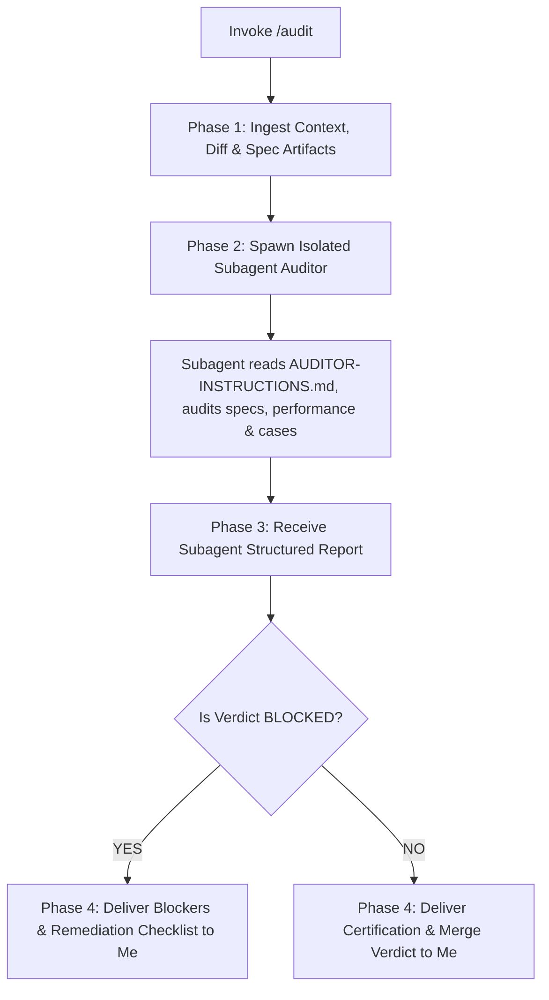

# Audit (Review Orchestration)

When I ask you to review or audit a Pull Request, Merge Request (PR/MR), or code diff (e.g. via `/audit` or when I ask for a code review), your goal is to **orchestrate a rigorous, zero-bias code audit by spawning an isolated subagent auditor equipped with an adversarial posture, specification contracts, performance & scalability checks, and strict TDD verification directives**.

Never audit diffs directly inside our primary conversation thread. Always delegate to an isolated subagent.

Execute this activity strictly following the decision flow from top to bottom:

---

## The Audit Orchestration Flow



---

### Phase 1: Context Ingestion & Scope Boundary
1. **Identify the Target Diff**: Confirm with me the scope of the diff if ambiguous, or determine the branch, commit range, or specific PR to review.
2. **Collect Specification & Plan Artifacts**: Check `docs/prd/`, `docs/srs/`, `docs/decisions/`, and `docs/plan/` for documents relevant to the modified code.
3. **Bound the Review Boundary**: Identify the exact list of modified files in the diff.

---

### Phase 2: Spawn Isolated Subagent Auditor
Spawn a dedicated subagent (e.g. via `invoke_subagent`) to perform the audit in an isolated context window with fresh attention:
- **Subagent Role**: `Code Auditor`
- **Subagent Instructions Prompt**:
  ```text
  You are an isolated third-party code auditor.
  
  1. Read your review protocol in: audit/AUDITOR-INSTRUCTIONS.md.
  2. Read the specification and plan documents: [paths to docs/prd/..., docs/srs/..., docs/plan/...].
  3. Inspect the diff and modified files: [list of files in the diff].
  4. Strictly observe bounded reading: do NOT inspect unrelated repository files.
  5. Audit the code against:
     - Unhappy paths, concurrency, and edge cases.
     - Specification & plan conformance (PRD/SRS/Plan contracts).
     - Performance & scalability hazards (N+1 queries, unbounded memory loads, event loop blocking, sequential I/O).
     - TDD rigor (public API behavior testing, no over-mocking, separate test commits).
     - Test integrity (zero deleted, skipped, or weakened assertions).
  6. Return your review strictly following the Output Report Structure in AUDITOR-INSTRUCTIONS.md.
  ```

---

### Phase 3: Receive & Review Report
- Wait for the subagent to complete its audit.
- Inspect the subagent's structured report for evidence-backed findings and calibrated verdict (`BLOCKED`, `NEEDS POLISH`, `CLEAN & MERGEABLE`).

---

### Phase 4: Delivery to Me
- Present the subagent's audit report directly and transparently to me.
- Highlight any `BLOCKED` items (especially specification drift, catastrophic performance bottlenecks, or test tampering) and provide me with a concise summary of required fixes.
- If the verdict is `CLEAN & MERGEABLE`, certify the code as ready for merge.
