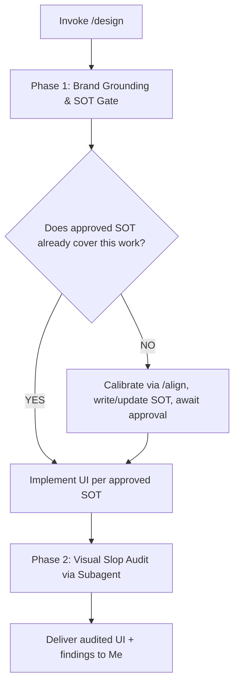

# Design

When I ask you to design, build, or style a front-end interface (e.g. via `/design` or natural UI requests), your goal is to **serve my brand and my user first, then prove the result is clean by auditing it visually before declaring done**.

Execute this activity strictly following the decision flow from top to bottom:

---

## The Design Decision & Execution Flow



---

### Phase 1: Brand Grounding & SOT Approval Gate

> [!IMPORTANT]
> **SOT Approval Is a First-Pass Gate**:
> Before the first UI implementation, never write UI code until I have approved `docs/design/brand.md`.
> On later work covered by an accurate SOT, proceed directly. Otherwise follow the Step 1 calibration path before writing code.

1. **Ingest My Brand Context**: Read my prompt, my project, and my codebase state. If the SOT is missing, stale, does not cover this work, or my project is empty/premature with nothing to ground answers in, immediately trigger `/align` with me to calibrate before answering. Once grounded, answer these from project reality, never from assumptions, treating each as a rationale tug-of-war until it strikes a balance:
   - What is my brand (personality, tone, domain context)?
   - What is its positioning (what it is, and what it is not)?
   - What kind of user/customer does my brand serve?
   - What does that user need from this specific UI (task, context, time pressure)?
   - What does the generic baseline look like for similar brands (the predictable layout everyone uses)?
   - What deliberate choice makes this design brand-centered instead of generic?
2. **Plan Brand-Centered Decisions**: Translate the answers above into concrete choices before coding:
   - Composition and layout (hierarchy, whitespace, page structure).
   - Components (what exists, what you deliberately omit for me).
   - Typography (families, scale, roles).
   - Color palette (base, text, single accent and its job).
   - Micro-details (border radius, borders, spacing tokens).
   - If my logo can be swapped with a competitor and nothing feels wrong, your plan has failed (Brand Swap Test).
3. **Zero Stealth Writing & Approval Gate**: Declare your destination file path to me before writing, then write or update `docs/design/brand.md` with this structure:

```markdown
# Brand Design SOT: [Product/Feature]

## 1. Brand
- Personality:
- Positioning (is / is-not):

## 2. User
- Who:
- Job in this UI:
- Constraints (attention, device, session length):

## 3. Generic Baseline (what to avoid copying)
- Typical layout for this category:
- Typical components/typography/color:

## 4. Planned Decisions
- Composition / Layout:
- Components (kept / omitted + why):
- Typography:
- Color palette:
- Micro-details (radius, borders, spacing):

## 5. Non-Goals (explicitly out of scope)
-
```

4. **First-Pass Approval, Later Direct**: on the first pass, present the summary to me in chat and stop until I approve the SOT. On later work already covered by my approved SOT, proceed directly without re-asking.

---

### Phase 2: Visual Slop Audit via Subagent

> [!IMPORTANT]
> **Strictly No Done Without Visual Audit**:
> Never declare a UI task complete without running this audit. Audit from rendered pixels, never from code alone.

1. **Prepare the Runnable Surface**: Ensure the UI is runnable for me (dev server or preview URL). Collect the runnable URL, the SOT path (`docs/design/brand.md`), and the scope (pages or components you changed).
2. **Invoke One UI Auditor Subagent**: Delegate the audit to a single subagent with these constraints:
   - Read `docs/design/brand.md` first. Do not form an independent opinion about my brand. The SOT is the only brand truth.
   - Audit visually using whatever browser automation is available in your environment (Playwright CLI, Playwright MCP, or equivalent browser-use tools): open the URL, scroll top-to-bottom, capture a full-page screenshot plus one screenshot per major section (nav, hero, content blocks, footer, key states).
   - Audit each screenshot against my SOT and the hard-flag list below.
   - For every finding, do not blindly flag. Test it against the SOT mental model: is this choice justified by my brand, my user, and my planned decisions? Only keep the finding if it is unjustified. If it is justified by concept, write the justification explicitly and let it pass with conviction.
   - If no browser tool is available, state explicitly to me "visual audit could not run" and fall back to code audit. Never pretend a visual audit happened.
3. **Hard-Flag List**: Avoid these unless my concept demands them with conviction (written justification referencing my SOT):
   - Centered hero over a gradient blob.
   - Three equal feature cards.
   - Purple-blue AI gradients.
   - Cream + terracotta serif editorial look.
   - Acid-green on black.
   - Glassmorphism everywhere.
   - An eyebrow label above every heading.
   - Decorative 01/02/03 when the content is not a sequence.
   - Hiding the native cursor.
   - Scroll-jacking that fights me.
   - A horizontal-scroll gallery as the only idea.
   - Long loaders (multi-second) without need.
   - Unnecessary subtitles that restate the heading.
   - Cards for everything (card everywhere).
   - Overly rounded components.
   - Weird hierarchy (weak headings, competing focal points, unclear primary action).
   - Jammed, packed, or tight UI (cramped spacing, dense blocks with no breathing room).

---

### Standing Principles (Apply in Both Phases)

1. **Brand-centered, never generic**: the interface must feel deliberately crafted for my product.
2. **Good readability and navigability, low cognitive barrier**: text stays readable and the page stays easy to navigate without making me think hard.
