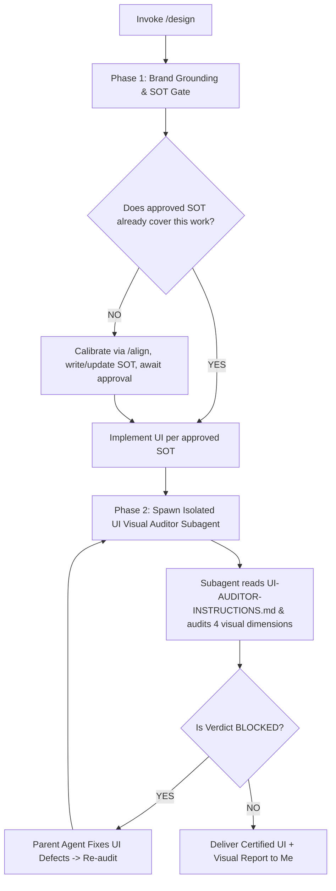

# Design

When I ask you to design, build, or style a front-end interface (e.g. via `/design` or natural UI requests), your goal is to **serve my brand and my user first, adhere strictly to `## Engineering Rules & Directives` in your active harness configuration (`GEMINI.md` at `~/.gemini/GEMINI.md` or `AGENTS.md` at `~/.agents/AGENTS.md` / `~/.config/opencode/AGENTS.md`), then prove the result is clean by auditing it visually before declaring done**.

Execute this activity strictly following the decision flow from top to bottom:

---

## The Design Decision & Execution Flow



---

### Phase 1: Brand Grounding & SOT Approval Gate

> [!IMPORTANT]
> **SOT Approval Is a First-Pass Gate**:
> Before the first UI implementation, never write UI code until I have approved `docs/design/brand.md`.
> On later work covered by an accurate SOT, proceed directly. Otherwise follow the Step 1 calibration path before writing code.

1. **Ingest My Brand Context**: Read my prompt, my project, and my codebase state. If the SOT is missing, stale, does not cover this work, or my project is empty/premature with nothing to ground answers in, immediately trigger `/align` with me to calibrate before answering. Once grounded, answer these from project reality, never from assumptions, treating each as a rationale tug-of-war until it strikes a balance:
   - What is my brand (personality, tone, domain context)?
   - What is its positioning (what it is, and what it is not)?
   - What kind of user/customer does my brand serve?
   - What does that user need from this specific UI (task, context, time pressure)?
   - What does the generic baseline look like for similar brands (the predictable layout everyone uses)?
   - What deliberate choice makes this design brand-centered instead of generic?
2. **Plan Brand-Centered Decisions**: Translate the answers above into concrete choices before coding:
   - Composition and layout (hierarchy, whitespace, page structure).
   - Components (what exists, what you deliberately omit for me).
   - Typography (families, scale, roles).
   - Color palette (base, text, single accent and its job).
   - Micro-details (border radius, borders, spacing tokens).
   - If my logo can be swapped with a competitor and nothing feels wrong, your plan has failed (Brand Swap Test).
3. **Zero Stealth Writing & Approval Gate**: Declare your destination file path to me before writing, then write or update `docs/design/brand.md` with this structure:

```markdown
# Brand Design SOT: [Product/Feature]

## 1. Brand
- Personality:
- Positioning (is / is-not):

## 2. User
- Who:
- Job in this UI:
- Constraints (attention, device, session length):

## 3. Generic Baseline (what to avoid copying)
- Typical layout for this category:
- Typical components/typography/color:

## 4. Planned Decisions
- Composition / Layout:
- Components (kept / omitted + why):
- Typography:
- Color palette:
- Micro-details (radius, borders, spacing):

## 5. Non-Goals (explicitly out of scope)
-
```

4. **First-Pass Approval, Later Direct**: on the first pass, present the summary to me in chat and stop until I approve the SOT. On later work already covered by my approved SOT, proceed directly without re-asking.
5. **Implementation Directives (Engineering Rules & Directives)**: When implementing front-end code, strictly comply with `## Engineering Rules & Directives` from your active harness config (`GEMINI.md` / `AGENTS.md`):
   - **Locality of Behavior**: Co-locate markup, styling, and UI logic in deep, focused component files.
   - **AHA > DRY**: Avoid premature abstraction or extracting micro-components repeated < 3 times.
   - **Boring, Obvious Code**: Flatten control flow, avoid boolean traps in component props, and keep code easy to trace in under 30 seconds.
   - **Zero UI Unit Tests**: Never create unit tests for UI rendering, styling, or layout (per Directive #5). Visual verification is handled exclusively in Phase 2 via the isolated visual auditor subagent.

---

### Phase 2: Visual Slop & Quality Audit via Subagent

> [!IMPORTANT]
> **Strict Anti-Self-Audit Gate**:
> The primary agent must NEVER audit rendered UI screenshots directly in the primary conversation thread. Inspecting your own UI implementation introduces self-confirmation bias and superficial macro-shape checking. Always delegate visual verification to an isolated subagent.

1. **Prepare the Runnable Surface & Visual Evidence**:
   - Ensure the UI is runnable (dev server or preview URL).
   - Capture rendered screenshots across at least two standard viewports using browser automation (Playwright MCP or CLI):
     - **Mobile Viewport**: 360x640px (or similar narrow screen).
     - **Desktop Viewport**: 1280x800px (or standard workstation screen).
   - Ensure screenshots capture active interaction states (e.g. open modal, expanded accordion, validation error state) rather than just passive static loads.
   - If no browser tool is available in your environment, state explicitly to me "visual audit could not run" and fall back to code audit. Never pretend a visual audit happened.

2. **Spawn Isolated UI Visual Auditor Subagent**:
   Dispatch a dedicated subagent (e.g. via `invoke_subagent`) acting as the **End-User Advocate and Quality Defense for the Codebase Owner**:
   - **Subagent Role**: `UI Visual Auditor`
   - **Subagent Instructions Prompt**:
     ```text
     You are an isolated third-party Visual and UI/UX Quality Assurance Auditor representing the end-user and the codebase owner.

     1. Read your audit protocol in: design/UI-AUDITOR-INSTRUCTIONS.md.
     2. Read the brand Single Source of Truth in: docs/design/brand.md.
     3. Inspect the modified UI files: [list of view files].
     4. Inspect the rendered screenshots / preview URL: [paths to screenshots / URL].
     5. Context of visual task: [Describe specific task, e.g. "Migrated inline upload form to responsive bottom-sheet/modal dialog"].
     6. Audit the rendered pixels against the 4 Dimensions of Visual Testing (Core, Boundaries, Errors, Invariants) with an adversarial, skeptical posture.
     7. Return your audit report strictly following the Output Report Structure in UI-AUDITOR-INSTRUCTIONS.md.
     ```

3. **Process Subagent Verdict & Remediation**:
   - **`BLOCKED`**: Immediately resolve the reported defects in code, re-capture fresh screenshots, and re-invoke the subagent auditor until certified. Never bypass or ignore blockers.
   - **`PASS & CERTIFIED`**: Deliver the verified UI, subagent audit report, and certified screenshots to me.

4. **Hard-Flag List**: Avoid these unless my concept demands them with conviction (written justification referencing my SOT):
   - Centered hero over a gradient blob.
   - Three equal feature cards.
   - Purple-blue AI gradients.
   - Cream + terracotta serif editorial look.
   - Acid-green on black.
   - Glassmorphism everywhere.
   - An eyebrow label above every heading.
   - Decorative 01/02/03 when the content is not a sequence.
   - Hiding the native cursor.
   - Scroll-jacking that fights me.
   - A horizontal-scroll gallery as the only idea.
   - Long loaders (multi-second) without need.
   - Unnecessary subtitles that restate the heading.
   - Cards for everything (card everywhere).
   - Overly rounded components.
   - Weird hierarchy (weak headings, competing focal points, unclear primary action).
   - Jammed, packed, or tight UI (cramped spacing, dense blocks with no breathing room).

---

### Standing Principles (Apply in Both Phases)

1. **Brand-centered, never generic**: the interface must feel deliberately crafted for my product.
2. **Good readability and navigability, low cognitive barrier**: text stays readable and the page stays easy to navigate without making me think hard.
