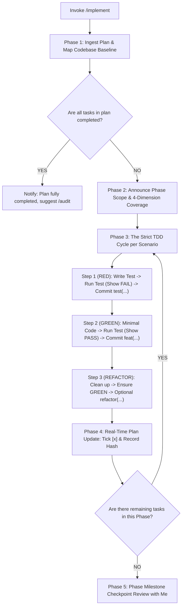

# Implement (TDD Plan Execution)

When I ask you to implement code (e.g. via `/implement` or natural execution requests), your goal is to **faithfully execute the approved roadmap in `docs/plan/`, working phase-by-phase with strict TDD cycles (Red -> Green -> Refactor), committing tests and implementation separately, and recording real-time progress and Git commit hashes directly in the plan document**.

Never write code without an existing, approved plan in `docs/plan/`. If no plan exists, instruct me to run `/plans` first.

Execute this activity strictly following the decision flow from top to bottom:

---

## The TDD Implementation Decision & Execution Flow



---

### Phase 1: Ingest Plan, Active Phase Discovery & Baseline Mapping
1. **Locate & Read the Plan**: Inspect `docs/plan/` to find the active plan matching the discussion or prompt (formatted as `docs/plan/YYYYMMDD_<plan_slug>.md`).
2. **Identify the Active Phase & Task Pair**: Scan for the first phase containing unchecked tasks (`- [ ]`).
3. **Inspect Task Scope**: Read the linked `REQ-XXX` requirements, target files, proposed commit messages, and verification commands.
4. **Map Codebase Baseline in Target Area**:
   - Inspect existing source code, signatures, types, and invariants in the files that will be modified or extended.
   - Grounding the implementation in existing codebase reality upfront eliminates false assumptions and prevents test tampering friction.

---

### Phase 2: Phase Scope Announcement & Coverage Intent
Before touching any code files, declare the execution boundary:
- State which Phase is being started.
- List the planned sequence of TDD scenario pairs for this phase.
- Explicitly state the test coverage intent across the 4 dimensions: **normal path**, **boundaries (edge cases)**, **error paths**, and **core invariants**.

---

### Phase 3: The Strict TDD Execution Cycle
Execute each scenario strictly through the **Red -> Green -> Refactor** sequence:

#### Step 1: RED (Write Test & Prove Failure)
1. **Write Test First**: Write the test asserting behavior through the public API (per Task X.Ya).
   - Strictly avoid over-mocking and avoid interaction tests checking "method called". Focus on real inputs, states, payloads, and side-effects.
   - **Concise "What & Why" Comments**: Include brief header comments in the test file explaining what behavior is being verified and why this invariant matters.
2. **Run Test Runner (Demonstrate Failure)**:
   - Run the specified test command.
   - **Show Output as Behavior Proof**: Display the failing test output in chat. Ensure logs are clean and clearly communicate the scenario description and failure reason from a behavior perspective so I can easily read and understand from a behavior perspective.
3. **Atomic Test Commit**:
   - Stage strictly the test files (`git add <test-files>`).
   - Commit using the proposed test commit message (e.g. `test(order): add failing test for discount calculation`).
   - Extract short commit hash (e.g. `a1b2c3d`).

#### Step 2: GREEN (Minimal Implementation & Prove Success)
1. **Minimal Implementation Only**: Write the minimal implementation code required to pass the test (per Task X.Yb). Do not add unrequested complexity or speculative extra features.
2. **Run Test Runner (Demonstrate Success)**:
   - Run the test suite. Must turn completely GREEN with clean, readable logs.
   - **Show Output as Behavior Proof**: Display the passing test runner output in chat as concrete proof of delivery.
3. **Atomic Feature Commit**:
   - Stage strictly the implementation files (`git add <src-files>`).
   - Commit using the proposed feature commit message (e.g. `feat(order): implement minimal tiered discount calculation`).
   - Extract short commit hash (e.g. `e4f5g6h`).

#### Step 3: REFACTOR (Clean Up while Staying Green)
1. If duplication or code clutter exists, refactor for clarity and maintainability without altering observable behavior.
2. Re-run tests to verify the green bar remains intact. If refactored, commit as `refactor(scope): ...`.

#### Non-Negotiable Anti-Tampering Rules:
> [!IMPORTANT]
> **Strictly No Test Tampering**:
> Never delete, skip (`it.skip`, `@Disabled`), or weaken assertions to make a failing test pass.
> If a test is discovered to be logically flawed or specifications change:
> 1. **STOP immediately**.
> 2. Explain the defect or architectural gap to me with exact line references and wait for my guidance.
> 3. Invoke `/align` to calibrate with me before making any changes to the test.

---

### Phase 4: Real-Time Plan Synchronization (Living Audit Trail)
Immediately after each commit succeeds, update the active plan document (`docs/plan/YYYYMMDD_<plan_slug>.md`) in real-time.
*(Note: Routine checklist ticking, commit hash appending, and progress counter updates preserve the existing plan filename without renaming it across calendar days.)*

1. **Tick Checkbox & Append Commit Hash**:
   Update the task item from:
   ```markdown
   - [ ] **Task 1.1a: [TEST] Write failing test for discount calculation**
     - **Fulfills**: `REQ-ORD-001`
     - **Files**: `[NEW] tests/unit/discount.test.ts`
     - **Commit**: `test(order): add failing test for discount calculation`
     - **Verification**: `npm test tests/unit/discount.test.ts` (EXPECTED: FAIL / RED)
   ```
   To:
   ```markdown
   - [x] **Task 1.1a: [TEST] Write failing test for discount calculation** (`a1b2c3d`)
     - **Fulfills**: `REQ-ORD-001`
     - **Files**: `[NEW] tests/unit/discount.test.ts`
     - **Commit**: `test(order): add failing test for discount calculation`
     - **Verification**: `npm test tests/unit/discount.test.ts` (FAILED as expected)
   ```
   And similarly tick Task 1.1b upon green bar commit (`e4f5g6h`).

2. **Update Metadata Counter & Progress Bar**:
   - Increment `completed_tasks` in frontmatter.
   - Update `status: in_progress` (or `status: completed` if this was the final task of the entire plan).
   - Update markdown progress bar and percentage at the top of the plan.

---

### Phase 5: Phase Milestone Checkpoint Review
Once all tasks within the active phase are completed:
1. **Pause for Review**: Stop execution to give me space to digest progress and prevent run-away modifications.
2. **Deliver Milestone Summary**:
   - Report the completed phase name.
   - List the created commit pairs (tests + feats) with their hashes and verified test outputs.
   - Display the updated overall plan progress (e.g. `6 / 12 Tasks Completed (50%)`).
3. **Awaiting Next Green Light**: Ask me for explicit confirmation before starting the next phase (e.g., *"Phase 1 is complete and all tests pass. Ready to proceed to Phase 2?"*).
