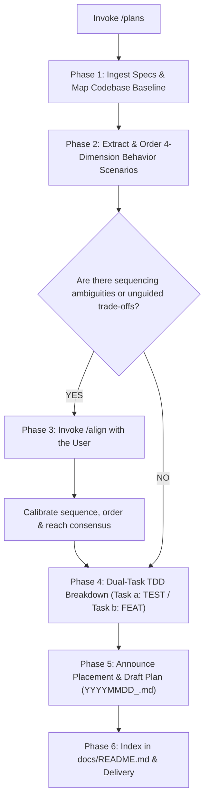

# Plans (TDD Implementation Planning)

When I ask you to create, draft, or refine an implementation plan (e.g. via `/plans` or natural planning requests), your goal is to **translate high-level PRD user outcomes and SRS technical specifications into an executable, commit-driven roadmap organized by behavioral TDD scenarios**.

Execute this activity strictly following the decision flow from top to bottom:

---

## The TDD Plans Decision & Execution Flow



---

### Phase 1: Ingest PRD & SRS Contracts & Baseline Mapping
1. **Locate Specifications**: Read the parent documents:
   - `docs/prd/YYYYMMDD_<feature_slug>.md` (Problem framing, user journeys, MVP scope).
   - `docs/srs/YYYYMMDD_<module_slug>.md` (Interface schemas, REQ identifiers, NFR targets).
2. **Anchor Requirements**: Every planned task must trace back to a specific `REQ-XXX` identifier or PRD User Story.
3. **Map Codebase Baseline in Target Area**:
   - Inspect existing source code, signatures, types, and invariants in the subsystems that will be modified or integrated.
   - Grounding test scenarios in the existing codebase reality upfront eliminates guesswork and mitigates test tampering down the line.

---

### Phase 2: Extract & Order Behavior Scenarios (4 Dimensions)
1. **Derive Scenarios from Public API Boundaries**:
   - Frame tests around behavioral interactions through the public interface/API.
   - Strictly avoid over-mocking and avoid assertions that merely verify "method X was called". Focus on inputs, observable states, returned payloads, and side-effects.
2. **Systematically Cover 4 Testing Dimensions**:
   Organize scenarios across four essential dimensions:
   - **Normal Path**: Core workflows and happy-path journeys.
   - **Boundaries (Edge Cases)**: Empty inputs, boundary limits, maximum payloads, off-by-one conditions.
   - **Error Paths**: Validation rejections, network failures, unauthorized requests, timeouts.
   - **Core Invariants**: Fundamental business integrity rules and system guarantees that must never be violated.
3. **Order by Design-Revealing Impact**:
   - Order scenarios from the most design-revealing (foundational schema, core interface contract, central domain rule) to peripheral edge cases and error handling.
   - Formulate scenario titles as clear behavioral statements (e.g. *"should reject order when inventory is insufficient"*) so the resulting test logs are instantly readable and understandable by the user.

---

### Phase 3: Technical Alignment Gate (Invoke `/align`)
> [!IMPORTANT]
> **No Unilateral Sequencing Assumptions**:
> If phase ordering, migration sequencing, or technical trade-offs are ambiguous:
> 1. Immediately invoke `/align`.
> 2. Present 2–3 sequencing strategies with pros and cons.
> 3. Align with the user before committing to the plan.

---

### Phase 4: Dual-Task TDD Breakdown (1 Scenario = 2 Atomic Commits)
In alignment with the core principles **"Take small steps"** and **"Commit test and implementation separately"**, every behavior scenario is broken down into an explicit pair of tasks:

- **Task X.Ya: [TEST] (The Red Phase)**:
  - Writes the targeted failing test asserting the scenario via the public API with concise "what and why" comments.
  - Expected verification result: **FAIL / RED** (proves the test is valid and detects the missing capability).
  - Proposed commit message: `test(<scope>): add failing test for <scenario>`
- **Task X.Yb: [FEAT] (The Green Phase)**:
  - Writes the minimal implementation code needed to satisfy the test.
  - Expected verification result: **PASS / GREEN** with clean, human-readable test logs.
  - Proposed commit message: `feat(<scope>): implement minimal logic for <scenario>`

---

### Phase 5: Placement Announcement & Document Authoring
1. **Zero Stealth Writing & Chronological Naming**: Declare destination file path before writing:
   - Target format: `docs/plan/YYYYMMDD_<plan_slug>.md` in full snake_case (e.g., `docs/plan/20261011_checkout_pipeline.md`).
   - **Chronological Revision Rule**: If this plan's tasks, scope, or structure are revised on a subsequent calendar date (via `/plans`), rename the file using `git mv` to match the new date (`YYYYMMDD_<plan_slug>.md`), update `last_updated: YYYY-MM-DD` in frontmatter, and synchronize references in `docs/README.md`.
   - **Preservation During Implementation**: Routine task completion ticking, commit hash recording, and progress bar updates during execution (`/implement`) preserve the plan filename without renaming.
2. **Required Implementation Plan Structure**:
   Structure the document with frontmatter:

   ```markdown
   ---
   title: Implementation Plan - [Feature Name]
   type: plan
   parent_prd: docs/prd/YYYYMMDD_[feature].md
   parent_srs: docs/srs/YYYYMMDD_[feature].md
   status: planned          # planned | in_progress | completed
   total_tasks: [Total Number of Sub-Tasks]
   completed_tasks: 0
   last_updated: YYYY-MM-DD
   ---

   # Implementation Plan: [Feature Name]

   > **Progress Tracker:** `[░░░░░░░░░░░░░░░░]` **0 / [Total] Tasks Completed (0%)**

   ---

   ## Phase 1: [Milestone Name]

   ### Scenario 1.1: [Behavior Description] (Normal Path / Boundary / Error / Invariant)
   - [ ] **Task 1.1a: [TEST] Write failing test for [Behavior]**
     - **Fulfills**: `REQ-XXX`
     - **Files**: `[NEW] tests/unit/...test.ts`
     - **Commit**: `test(scope): add failing test for [behavior]`
     - **Verification**: `npm test path/to/test.ts` (EXPECTED: FAIL / RED)

   - [ ] **Task 1.1b: [FEAT] Implement minimal logic for [Behavior]**
     - **Fulfills**: `REQ-XXX`
     - **Files**: `[NEW/MODIFY] src/...`
     - **Commit**: `feat(scope): implement minimal logic for [behavior]`
     - **Verification**: `npm test path/to/test.ts` (EXPECTED: PASS / GREEN)
   ```

---

### Phase 6: Anti-Rot Indexing & Delivery
1. **Single Source of Map**: Open `docs/README.md` and catalog the new plan in the **Implementation Plans (Plan)** table with its title, linked SRS, status (`Planned`), progress (`0%`), and relative markdown link.
2. **Delivery**: Present an executive overview of the phases, test coverage across the 4 dimensions, total commit pairs, and execution roadmap in chat.
