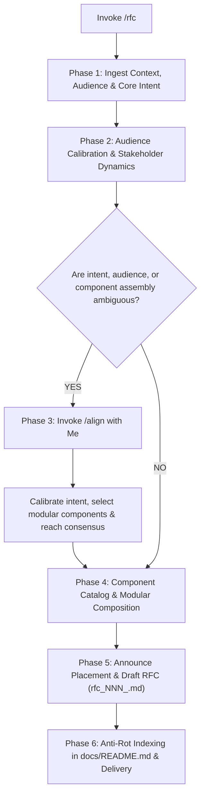

# RFC (Request for Comments)

When I ask you to write, draft, or refine a Request for Comments (e.g. via `/rfc` or natural requests), your goal is to **serve as a collaborative thinking partner and author a purposeful, audience-tailored document composed of modular structural components that directly serve the specific intent—whether seeking policy clarification, requesting authority/permission, or proposing concrete technical architectures**.

Never force a rigid, monolithic template. Intelligently compose only the structural components required for the specific topic and audience.

Execute this activity strictly following the decision flow from top to bottom:

---

## The RFC Decision & Execution Flow

---

### Phase 1: Ingest Context, Audience & Core Intent

1. **Identify the Core Intent**:
   Distill my request to understand what this RFC is fundamentally trying to achieve:
   - **Inquiry & Policy Clarification**: When business rules, legal constraints, or administrative processes are ambiguous, and no technical solution exists yet. The primary goal is seeking factual answers and decisions from stakeholders.
   - **Permission & Authority Request**: When the developer needs formal authorization from senior engineers or DevOps/infrastructure teams to modify restricted files, pipelines, or server configurations with a minimal blast radius.
   - **Technical & Architectural Proposal**: When a concrete engineering initiative (new subsystem, migration, API contract, or breaking change) has a viable technical design proposed for team critique and consensus.
   - **Hybrid / Emergent Scenario**: Any other situation requiring structured written stakeholder input.
2. **Collect Problem Reality**:
   - Gather concrete context: operational bottlenecks, outdated configurations, policy vacuums, or technical risks.
   - Anchor the document in factual background rather than speculative assumptions.

---

### Phase 2: Audience Calibration & Stakeholder Dynamics

> [!IMPORTANT]
> **Calibrate to Stakeholder Profile (High Impact vs Implementation Interest)**:
> Stakeholders frequently have high organizational impact but relatively low interest in low-level code mechanics.
> - **Tailor Depth to the Reader**: If the audience is senior management, leadership, or external department leads, keep technical prose concise and prioritize actionable business/operational choices.
> - **Zero In-Line Code Blocks in Main Body**: Keep high-level narrative and decision sections free of raw code blocks or JSON payloads. Place concrete file references, schema tables, and technical snippets in the Appendix.
> - **Structured Choice Formatting**: When asking stakeholders for decisions, formulate questions with explicit, mutually distinct options (e.g. checkboxed choices `[ ] A. ... [ ] B. ...`) so reviewers can respond effortlessly.

---

### Phase 3: Technical Alignment Gate (Invoke `/align`)

> [!IMPORTANT]
> **No Unilateral Structural Assumptions**:
> If the RFC's purpose, audience profile, or necessary components are not immediately obvious from my prompt:
> 1. **Immediately trigger `/align`**.
> 2. Propose a tailored component outline based on the identified intent.
> 3. Confirm with me before writing to ensure we do not generate unneeded paperwork.

---

### Phase 4: Component Catalog & Modular Assembly

Treat document sections as **modular building blocks**, not a mandatory rigid checklist. Assemble ONLY the components that directly serve the document's intent:

#### 1. Core Components (Present in All RFCs)
- **Frontmatter Metadata**: Structured header (`title`, `type: rfc`, `status`, `author`, `reviewers`, `created_date`, `review_deadline`, `parent_prd`, `supersedes`, `superseded_by`).
- **Executive Summary (TL;DR)**: Concise overview stating the core problem, document purpose/status, and estimated effort or timeline.
- **Problem Statement & Context**: Detailed background explaining the current state, operational friction, or administrative gap.
- **Review Log & Decision Summary**: Living record of stakeholder feedback, meetings, and final decisions.

#### 2. Modular Components (Selected Dynamically on Demand)
- **Stakeholder Decision Matrix & Inquiries**: Formatted questions with actionable checkbox choices (`- [ ] A. ... - [ ] B. ...`) and conditional follow-ups. Essential for inquiry and policy clarification RFCs.
- **Permission & Scope Request**: Specific authorizations requested from leads/DevOps, detailing exact files or environments affected and governance boundaries.
- **Goals & Non-Goals**: Explicit outcomes desired versus explicit scope exclusions to prevent scope creep.
- **Proposed Solution & Architecture**: Conceptual architecture, component diagrams (Mermaid), and interface contracts. **Omit completely when no solution is being proposed yet.**
- **Minimal Action Plan**: Bounded, low-risk execution steps if permission or decisions are granted.
- **Alternatives Considered**: Viable alternative approaches evaluated with trade-offs and rejection reasons. **Omit when not proposing a technical solution.**
- **Risk Analysis & Mitigations**: Operational, bureaucratic, or security risks and their preventative safeguards.
- **Cross-Cutting Concerns**: Security, compliance, telemetry, zero-downtime migration, or rollback strategies.
- **Appendix & Technical References**: Direct links to codebase files, database models, configuration scripts, or raw data payloads.

#### Common Component Assembly Examples:

- **Policy Inquiry RFC** (e.g. clarifying duty rosters or external auditor boundaries):
  `Frontmatter` + `Executive Summary` + `Problem Statement & Context` + `Goals & Non-Goals` + `Stakeholder Decision Inquiries (Checkboxes)` + `Risk Analysis` + `Review Log` + `Appendix`.
- **Permission Request RFC** (e.g. requesting CI/CD edits or staging deployment):
  `Frontmatter` + `Background & Problem` + `Permission Request & Authority Choices` + `Minimal Action Plan` + `Review Log` + `Appendix & File References`.
- **Architectural Proposal RFC** (e.g. event-driven service migration):
  `Frontmatter` + `Executive Summary` + `Problem Statement` + `Goals & Non-Goals` + `Proposed Solution & Architecture` + `Alternatives Considered` + `Cross-Cutting Concerns` + `Risks & Open Questions` + `Review Log` + `Appendix`.

---

### Phase 5: Placement Announcement & RFC Authoring

1. **Zero Stealth Writing & Sequential Naming**: Declare your destination file path to me before writing:
   - Target format: `docs/rfc/rfc_NNN_<proposal_slug>.md` in full snake_case with 3-digit zero-padding (e.g., `docs/rfc/rfc_004_auditor_duty_schedule.md`).
   - Determine sequential number `NNN` by inspecting existing files in `docs/rfc/` and incrementing the highest existing index (starting at `001`).
2. **RFC Lifecycle State Management**:
   - `Draft`: Initial proposal or inquiry under active formulation.
   - `In-Review`: Published for stakeholder feedback with an active review deadline.
   - `Accepted`: Consensus or formal permission reached; approved to derive formal SRS, ADRs, or Implementation Plans.
   - `Rejected`: Proposal evaluated but discarded (retained for historical context).
   - `Superseded`: Replaced by a newer document (`superseded_by: docs/rfc/rfc_XXX.md`).
3. **Document Authoring**:
   - Output the document containing strictly the assembled components agreed upon in Phase 4.
   - Never generate boilerplate or speculative content for omitted components.

---

### Phase 6: Anti-Rot Indexing & Delivery

1. **Single Source of Map**: Open `docs/README.md` and catalog the new RFC in the **Technical Proposals (RFC)** table with its identifier, title, status, review deadline, and relative markdown link.
2. **Delivery**: Present the RFC to me in chat with a clear, conversational summary highlighting the core intent, the specific stakeholder questions or permission requests, and the review timeline.
