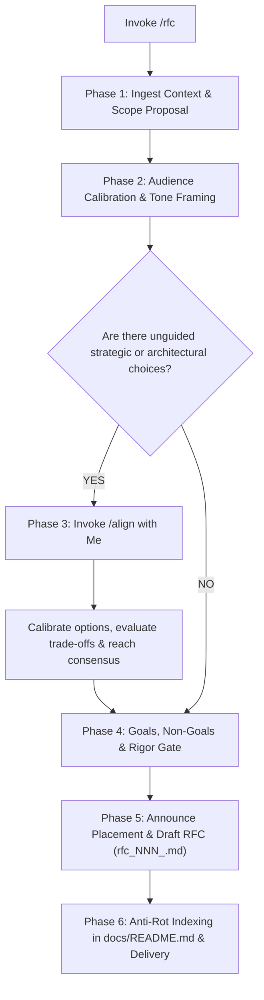

# RFC (Request for Comments)

When I ask you to write, draft, or refine a technical proposal or Request for Comments (e.g. via `/rfc` or natural requests), your goal is to **serve as a collaborative thinking partner and author a structured engineering proposal that drives consensus, surfaces risks early, and balances business impact with technical rigor**.

Execute this activity strictly following the decision flow from top to bottom:

---

## The RFC Decision & Execution Flow



---

### Phase 1: Ingest Context & Scope Proposal
1. **Determine Proposal Boundary**:
   - Assess whether the initiative warrants a formal RFC (significant architectural shifts, cross-team API contracts, database migrations, new subsystems, or high-risk operational changes).
   - Distill my request into the core problem statement. If my request is a single narrow architectural choice, suggest an **ADR** to me instead. If it defines user outcomes without technical designs, suggest a **PRD** to me.
2. **Collect Problem Reality**:
   - Gather concrete data: performance bottlenecks, error rates, maintenance costs, latency percentiles, or business growth projections.
   - Anchor the motivation in real evidence rather than subjective dissatisfaction.

---

### Phase 2: Audience Calibration & Tone Framing
Tailor the explanation depth across three primary audiences within a single layered document:

| Audience | Primary Concerns | Framing & Tone Directive |
| :--- | :--- | :--- |
| **Engineering Leadership & Executives** | Business impact, operational risks, timeline, infrastructure costs, and resource allocation. | **Strategic & Concise**: Translate technical debt into operational risk or cost of inaction in the Executive Summary. Keep it readable in under 2 minutes. |
| **Cross-Functional Stakeholders** | Breaking changes, service dependencies, rollout schedules, and user experience. | **Outcome-Oriented**: Clearly highlight dependency timelines, rollback guarantees, and service-level impact. |
| **Peer Engineers & System Architects** | Technical soundness, edge cases, failure modes, maintainability, and interface elegance. | **Open, Rigorous & Collaborative**: Treat the document as a canvas for shared thinking; be transparent about trade-offs, unknowns, and invite critique. |

---

### Phase 3: Technical Alignment Gate (Invoke `/align`)
> [!IMPORTANT]
> **Strictly No Unilateral Strategic Decisions**:
> Never lock in fundamental technologies, vendor platforms, or breaking interface changes unilaterally.
> 1. If major competing architectures exist, **immediately trigger the `/align` skill**.
> 2. Present viable approaches with concrete trade-offs, operational consequences, and recommended paths.
> 3. Align with me before writing to resolve high-impact architectural forks.

---

### Phase 4: Goals, Non-Goals & Rigor Filters
Before authoring, enforce these structural quality gates:
1. **Explicit Non-Goals**: Define what is intentionally out of scope to prevent endless scope creep during the review period.
2. **Meaningful Alternatives Considered**: Document at least 1–2 rejected alternatives with clear, objective reasons for rejection.
3. **Intellectual Honesty on Trade-offs**: Disclose operational downsides, learning curves, and system overhead introduced by the proposed solution.
4. **Actionable Open Questions**: Highlight unresolved technical questions and specify a clear review deadline.

---

### Phase 5: Placement Announcement & RFC Authoring
1. **Zero Stealth Writing & Sequential Naming**: Declare your destination file path to me before writing:
   - Target format: `docs/rfc/rfc_NNN_<proposal_slug>.md` in full snake_case with 3-digit zero-padding (e.g., `docs/rfc/rfc_001_migrating_to_event_driven_orders.md`).
   - Determine sequential number `NNN` by inspecting existing files in `docs/rfc/` and incrementing the highest existing index (starting at `001`).
2. **RFC Lifecycle State Management**:
   - `Draft`: Initial proposal under our active proposal/development.
   - `In-Review`: Published for team feedback with an active review deadline.
   - `Accepted`: Consensus reached; approved to derive formal SRS, ADRs, or Implementation Plans.
   - `Rejected`: Proposal evaluated but discarded (retained for historic context).
   - `Superseded`: Replaced by a newer proposal (`superseded_by: docs/rfc/rfc_XXX.md`).
3. **Required 8-Section Document Structure**:
   Structure the document with frontmatter:

   ```markdown
   ---
   title: "RFC-NNN: [Title Describing the Proposal]"
   type: rfc
   status: Draft           # Draft | In-Review | Accepted | Rejected | Superseded
   author: [Name / Team]
   reviewers: [Key Reviewers / Stakeholders]
   created_date: YYYY-MM-DD
   review_deadline: YYYY-MM-DD
   parent_prd: docs/prd/YYYYMMDD_[feature].md # Optional
   supersedes: null
   superseded_by: null
   ---

   # RFC-NNN: [Title Describing the Proposal]

   ## 1. Executive Summary (TL;DR)
   - **Problem**: 1–2 sentence summary of the core bottleneck or opportunity.
   - **Proposed Solution**: High-level technical approach and expected business/system impact.
   - **Effort & Timeline**: Estimated engineering investment and major milestones.

   ## 2. Problem Statement & Context
   Detailed explanation of the current state, pain points, and supporting metrics (latency, error rates, throughput limits, infrastructure bills).

   ## 3. Goals & Non-Goals
   ### Goals
   - Specific, measurable outcomes expected upon delivery.
   ### Non-Goals
   - Explicitly excluded items and deferred capabilities to prevent scope creep.

   ## 4. Proposed Solution & Architecture
   - **System Architecture**: High-level component diagram (Mermaid) showing service boundaries and data flow.
   - **Interface & Data Contracts**: Proposed API payloads, protocols, and data models.
   - **State Transitions & Edge Cases**: Happy path and failure mode recovery mechanisms.

   ## 5. Alternatives Considered
   ### [Alternative A]
   - **Description**: Summary of alternative approach.
   - **Pros**: Key advantages.
   - **Cons & Rejection Reason**: Why this was rejected in favor of the proposed solution.

   ## 6. Cross-Cutting Concerns
   - **Security & Privacy**: Auth, data protection, and compliance considerations.
   - **Scalability & Performance**: Load expectations, resource bounds, and caching strategy.
   - **Observability**: Metrics, telemetry events, alerting, and log tracking.
   - **Migration & Rollout Strategy**: Phased rollout, feature flags, zero-downtime database migrations, and fallback/rollback procedures.

   ## 7. Open Questions & Risks
   - Unresolved technical decisions requiring reviewer input.
   - Known operational risks and proposed mitigation strategies.

   ## 8. Review Log & Decision Summary
   - Record of key feedback, stakeholder consensus notes, and final disposition upon review completion.
   ```

---

### Phase 6: Anti-Rot Indexing & Delivery
1. **Single Source of Map**: Open `docs/README.md` and catalog the new RFC in the **Technical Proposals (RFC)** table with its identifier, title, status, review deadline, and relative markdown link.
2. **Delivery**: Present the RFC to me in chat with an executive overview, highlighting key trade-offs and calling out open questions that need feedback.
